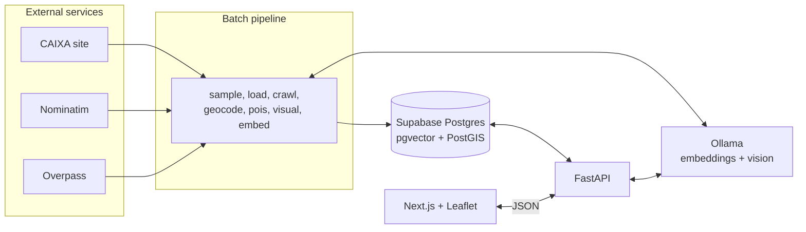
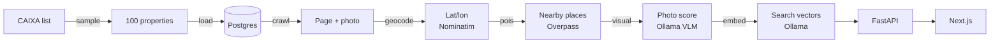

# Build an AI-powered application with open-source

BidRank: an AI real-estate search demo for CAIXA auction properties, built with open-source tools. Search by text, filters or map; each property has a photo-based visual score and nearby places.

## Structure

| Folder | What it is |
|---|---|
| `batch-pipelines/pipeline/` | CLI (`cli.py`), shared code (`common/`) and one package per stage in `stages/`: sample, load, crawl, geocode, pois, visual, embed |
| `batch-pipelines/api/` | FastAPI app (`/properties`, `/properties/{id}`, `/filters`) |
| `batch-pipelines/tests/` | pytest suite |
| `frontend/` | Next.js app (search page, property detail page, Leaflet maps) |
| `supabase/migrations/` | Postgres schema with pgvector and PostGIS, plus the search function |

Stack: Supabase (local Postgres), Ollama (`qwen3-embedding:0.6b` for embeddings, `qwen3.5:9b` for photo scoring), Nominatim (geocoding), Overpass (nearby places), Crawl4AI.

## Architecture



The pipeline fills Postgres once; at query time the API embeds the search text with Ollama and runs one SQL function that combines vector similarity, filters and distance to nearby places.

## Setup

Requires Docker, [uv](https://docs.astral.sh/uv/), Node 22 and [Ollama](https://ollama.com).

```bash
uv tool install pre-commit && pre-commit install
supabase start && supabase db reset
ollama pull qwen3-embedding:0.6b && ollama pull qwen3.5:9b
cd batch-pipelines && uv sync && uv run crawl4ai-setup
```

## Build the data



Run from `batch-pipelines/`, in this order (each stage is safe to re-run):

```bash
uv run pipeline load      # the committed sample of 100 properties (sample/properties.csv)
uv run pipeline crawl     # CAIXA page and photo
uv run pipeline geocode
uv run pipeline pois
uv run pipeline visual    # slow (~30 min); run before embed, the note is part of the search text
uv run pipeline embed
```

`uv run pipeline sample` draws a new sample and overwrites the committed one.

## Run the app

```bash
cd batch-pipelines && uv run uvicorn api.main:app --reload   # API on :8000
cd frontend && npm install && npm run dev                    # UI on :3000
```

## Tests and checks

```bash
cd batch-pipelines && uv run pytest -q && uv run ruff check . && uv run ruff format --check .
cd frontend && npm run lint && npm run format:check && npm run build
```

CI runs the same checks. See `AGENTS.md` for code conventions.
